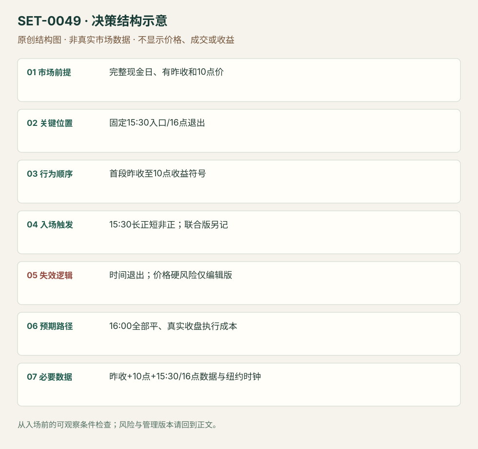

---
{
  "id": "SET-0049",
  "schema_version": "1.0.0",
  "name_zh": "首段收益方向驱动的最后半小时",
  "name_en": "First-to-last Half-hour Momentum",
  "aliases": [],
  "name_nature": "research_term",
  "status": "reviewed",
  "summary": "15:30才按今天首段收益的方向持仓最后30分钟，并在16:00结束。论文“首半小时收益”含昨收至今日10:00的隔夜部分，不是09:30开盘到10:00的纯现金收益。",
  "mechanism": "closing_momentum_predictability",
  "tags": [
    "quantitative",
    "closing",
    "ETF",
    "momentum"
  ],
  "pa_role": "non_primary",
  "markets_observed": [
    "SPY ETF",
    "QQQ/XLF/IWM/DIA/EEM/FXI/EFA/VWO/IYR/TLT（论文扩展）"
  ],
  "markets_supported": [],
  "migration_hypotheses": [],
  "session": "NYSE现金参考09:30–16:00 America/New_York；首段包含前日16:00至今日10:00，但持仓只15:30–16:00。半日另立版本，不将13:00日默认为16:00。",
  "session_tags": [
    "closing"
  ],
  "context_timeframe": "昨现金收盘至今日10:00收益；15:30执行窗口",
  "trigger_timeframe": "30分钟窗口、固定15:30执行",
  "data_requirements": [
    "intraday_prices",
    "previous_close",
    "session_clock"
  ],
  "execution_mode": "systematic_source_version",
  "source_ids": [
    "SRC-0081"
  ],
  "evidence_ids": [
    "EVD-000097",
    "EVD-000106"
  ],
  "visual_ids": [
    "VIS-000106"
  ],
  "rule_completeness": "前提/触发/失效/管理已记录；来源与编辑模块分开",
  "independent_corroboration": "limited_single_family",
  "profit_evidence": "author_backtest_not_reproduced",
  "created": "2026-10-02",
  "updated": "2026-10-02",
  "reviewed_at": "2026-10-02",
  "known_gaps": [
    "未独立复现",
    "没有统一原始价格止损",
    "缺少真实单日视觉案例",
    "2014预印本与后续版本需继续比对"
  ],
  "logic_fingerprint": [
    "完整现金日、有昨收和10点价",
    "固定15:30入口/16点退出",
    "首段昨收至10点收益符号",
    "15:30长正短非正；联合版另记",
    "时间退出；价格硬风险仅编辑版",
    "16:00全部平、真实收盘执行成本",
    "昨收+10点+15:30/16点数据与纽约时钟"
  ],
  "environment_tags": [
    "closing",
    "time_of_day"
  ],
  "structure_locations": [
    "fixed_time_entry"
  ],
  "version": "1.0.0",
  "unknown_fields": {},
  "review_scope": "规则记录、引用范围、日内边界、逻辑区别与已看静态画面；不含独立回测、动态逐笔或账户核验",
  "source_coverage": {
    "substantive_read_sources": 1,
    "families": [
      "gao-han-li-zhou"
    ],
    "core_support_source_ids": [
      "SRC-0081"
    ],
    "independence_note": "limited_single_family"
  },
  "method_families": [
    "quantitative_time"
  ],
  "market_types": [
    "ETF"
  ]
}
---

# 首段收益方向驱动的最后半小时 · First-to-last Half-hour Momentum

## 1. 名称与快速概览

15:30才按今天首段收益的方向持仓最后30分钟，并在16:00结束。论文“首半小时收益”含昨收至今日10:00的隔夜部分，不是09:30开盘到10:00的纯现金收益。

记录口径：PA non_primary；必要数据 intraday_prices、previous_close、session_clock。名称性质：来源术语或研究术语。reviewed 只表示本条规则与证据记录审查通过，盈利状态为 author_backtest_not_reproduced。

## 2. 本质与行为假说

论文发现首段与最后半小时收益有正向统计关系，并提出交易者行为解释。解释尚非因果证据；个体一日方向预测可能完全失败。

## 3. 适用市场与环境

2014-10作者预印本，SPY 1993-02-01至2013-12-31，另扩展10只ETF。保留该版本样本与日期；不把另一SSRN版本或今天环境悄悄替换。

**来源实用市场：**SPY ETF、QQQ/XLF/IWM/DIA/EEM/FXI/EFA/VWO/IYR/TLT（论文扩展）。

**Session：**NYSE现金参考09:30–16:00 America/New_York；首段包含前日16:00至今日10:00，但持仓只15:30–16:00。半日另立版本，不将13:00日默认为16:00。

跨市场：本版不主张已经验证的跨市场迁移；更换市场必须重定数据来源、流动性与session。

## 4. 出现前的观察清单

锁定前日16:00价、今日10:00价、15:30入口与16:00退出的纽约时钟、复权与半日处理。原论文日历变量历史发布时间不能拿今天日程去替。

## 5. 形成过程与状态转换

昨收参考 →10:00得到r1 → 等至15:30 →r1正则长、非正则短 →16:00平。联合版另看15:00–15:30 r12，异号不做。

## 6. Entry trigger 与执行方式

主符号策略r1=C(10:00)/C(昨16:00)−1，15:30按其正负入场；原公式零值归short。联合r1/r12同号版本按论文边界定义，不能仅挑交易日提高表面胜率。

## 7. Invalidation 与止损逻辑

原符号模型以固定30分钟暴露和16:00退出界定风险，没有统一价格硬止损。实务添加最大损失/硬止损是编辑新版本，必须重新检验，不能继承论文回报。拒绝无法承受该时间风险的样本。

## 8. Exit、target 与 trade management

16:00退出；须明确收盘集合成交、最后可成交报价与论文价格标记的差别。提前按图形获利/止损属于另一个退出版本。

## 9. 常见 variations

只用r1、只用r12、同号联合、回归预测下均值方差配置是同一预测关系的不同实现，不计四条。原联合版无交易日不纳入命中率分母，这个口径需保存。

## 10. 失败方式与不交易条件

误算首段为开盘收益；零值处理不一致；收盘价不可按理论标价成交；短融/交易费用；极端尾盘消息翻转；使用历史全年波动排名做实时选股过滤。

## 11. 与相近 setups 的区别

- [SET-0048](SET-0048.md)：0048 动态噪声带可多次入场、半小时检查；本条方向在早期确定但只最后半小时入场。
- [SET-0027](SET-0027.md)：0027 比较股票与指数相对响应，本条预测同一资产的不同时段。

## 12. 图表与案例解读

视觉缺口：已读论文规则、表5和成本段；未取得可核对的单日价格入场案例。绩效汇总和回归表不计真实交易图覆盖，后续可用原始数据画因果模拟图并明确标模拟。

**本地原创示意（VIS-000106，非真实市场数据）：**

小屏阅读可[打开原尺寸示意图](../assets/diagrams/SET-0049.svg)并缩放。

此图用于对照识别顺序与风险定义；不计入真实案例覆盖率。

## 13. 证据、分歧与未知项

单一富信息论文家族，规则与历史作者测试可还原，本研究未复现。论文用千股SPY和历史价格/佣金估成本，部分净收益讨论针对回归配置而非纯符号模型；不套成当下通用成本。

- [EVD-000097] Lei Gao; Yufeng Han; Sophia Zhengzi Li; Guofu Zhou，《Intraday Momentum: The First Half-Hour Return Predicts the Last Half-Hour Return (October 2014 preprint)》，[SRC-0081](https://smallake.kr/wp-content/uploads/2015/01/SSRN-id2440866.pdf)；定位：PDF页序6定义p0 /11–12符号策略 /16–17成本讨论 /31 Table5。支持：首段收益从昨16:00收盘到今10:00，15:30按符号长/短、16:00平；联合15:00–15:30同号版另记，研究与成本讨论不是当前收益保证。

审查例外：此条只有一份富信息原始资料，足以还原本条规则；独立佐证有限，未用背景页冒充第二份核验。后续优先寻找独立规则/失败案例。

- [EVD-000106] **编辑操作化，未测试：**实务可添加事前最大价格损失限制/硬止损，但这是新风险版，需要重新检验。 原文边界：原符号模型只固定15:30–16:00时间暴露，没有统一价格硬止损。

## 14. 可用于复盘的检查表

- [ ] 下单前的前提可核对：完整现金日、有昨收和10点价
- [ ] 事前标记位置：固定15:30入口/16点退出
- [ ] 行为按顺序出现：首段昨收至10点收益符号
- [ ] 实际触发符合选定版本：15:30长正短非正；联合版另记
- [ ] 事先写明本次否定条件：时间退出；价格硬风险仅编辑版
- [ ] 目标/路径只用当时已知信息：16:00全部平、真实收盘执行成本
- [ ] 数据满足 昨收+10点+15:30/16点数据与纽约时钟；记录时间、点差、滑点、队列和未成交
- [ ] 记录截止平仓及规则偏离；正常亏损不事后改成“未成立”

## 15. 后续验证问题

2014后样本和收盘成交机制有何变化？原首段含overnight贡献多少？纯符号与联合版成本后、无交易日分母差异？
