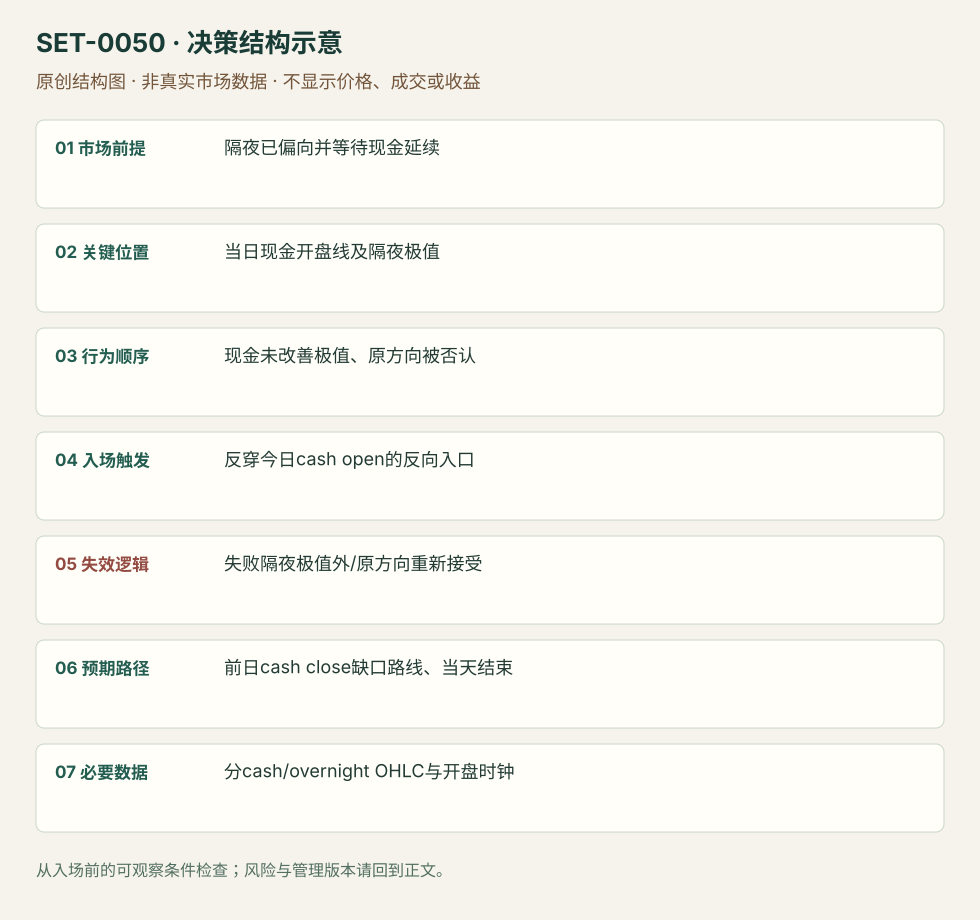

---
{
  "id": "SET-0050",
  "schema_version": "1.0.0",
  "name_zh": "隔夜方向失败后反穿现金开盘线",
  "name_en": "Overnight-position Reversal through Cash Open",
  "aliases": [],
  "name_nature": "editor_descriptive_with_source_term",
  "status": "reviewed",
  "summary": "隔夜交易已偏向一侧，现金开盘未能继续改善隔夜极值；价格反穿今天现金开盘线向相反方向时，交易隔夜方向失败与缺口回归。当天开盘线在决策中是独立参考。",
  "mechanism": "overnight_inventory_failure",
  "tags": [
    "opening",
    "overnight",
    "gap",
    "reversal"
  ],
  "pa_role": "core",
  "markets_observed": [
    "DAX（来源实际案例）",
    "S&P500期货（文字情境）"
  ],
  "markets_supported": [],
  "migration_hypotheses": [],
  "session": "DAX采用Europe/Berlin底层现金参考09:00–17:30；前后电子段单列。源图时区未明，实际迁移前需核数据商；ES文字若执行则09:30–16:00 America/New_York另立版本。",
  "session_tags": [
    "opening",
    "overnight"
  ],
  "context_timeframe": "日线/前一session + 当日执行图；因来源而异",
  "trigger_timeframe": null,
  "data_requirements": [
    "overnight_OHLC",
    "cash_open",
    "prior_cash_close"
  ],
  "execution_mode": "mixed",
  "source_ids": [
    "SRC-0014",
    "SRC-0006"
  ],
  "evidence_ids": [
    "EVD-000098",
    "EVD-000099"
  ],
  "visual_ids": [
    "VIS-000054",
    "VIS-000107"
  ],
  "rule_completeness": "前提/触发/失效/管理已记录；来源与编辑模块分开",
  "independent_corroboration": "limited_single_family",
  "profit_evidence": "not_established",
  "created": "2026-10-02",
  "updated": "2026-10-02",
  "reviewed_at": "2026-10-02",
  "known_gaps": [
    "未开展独立回测；实际订单成交与成本未知",
    "执行周期没有统一来源参数，使用前须锁定版本"
  ],
  "logic_fingerprint": [
    "隔夜已偏向并等待现金延续",
    "当日现金开盘线及隔夜极值",
    "现金未改善极值、原方向被否认",
    "反穿今日cash open的反向入口",
    "失败隔夜极值外/原方向重新接受",
    "前日cash close缺口路线、当天结束",
    "分cash/overnight OHLC与开盘时钟"
  ],
  "environment_tags": [
    "opening",
    "overnight_inventory"
  ],
  "structure_locations": [
    "today_cash_open"
  ],
  "version": "1.0.0",
  "unknown_fields": {
    "trigger_timeframe": "来源未提供统一执行周期；正文记录已知图例，不能当成统一参数"
  },
  "review_scope": "规则记录、引用范围、日内边界、逻辑区别与已看静态画面；不含独立回测、动态逐笔或账户核验",
  "source_coverage": {
    "substantive_read_sources": 2,
    "families": [
      "axia"
    ],
    "core_support_source_ids": [
      "SRC-0014",
      "SRC-0006"
    ],
    "independence_note": "limited_single_family"
  },
  "method_families": [
    "price_action_reversal",
    "opening_gap",
    "liquidity_inventory"
  ],
  "market_types": [
    "futures"
  ]
}
---

# 隔夜方向失败后反穿现金开盘线 · Overnight-position Reversal through Cash Open

## 1. 名称与快速概览

隔夜交易已偏向一侧，现金开盘未能继续改善隔夜极值；价格反穿今天现金开盘线向相反方向时，交易隔夜方向失败与缺口回归。当天开盘线在决策中是独立参考。

记录口径：PA core；必要数据 overnight_OHLC、cash_open、prior_cash_close。名称性质：编辑性描述名，英文保留来源术语以便检索。reviewed 只表示本条规则与证据记录审查通过，盈利状态为 not_established。

## 2. 本质与行为假说

隔夜参与可能包含短期投机/对冲，但不能概括成没有大参与者。假说是延续未兑现时脆弱方向退出；观察极值失败和开盘线反穿，不假装知道实际持仓。

## 3. 适用市场与环境

源例DAX隔夜在前高上买，现金未续；ES文字讲对冲情境。若现金一开即持续接受更高价格，或消息确实支持新价值，不能惯性回补缺口。

**来源实用市场：**DAX（来源实际案例）、S&P500期货（文字情境）。

**Session：**DAX采用Europe/Berlin底层现金参考09:00–17:30；前后电子段单列。源图时区未明，实际迁移前需核数据商；ES文字若执行则09:30–16:00 America/New_York另立版本。

跨市场：本版不主张已经验证的跨市场迁移；更换市场必须重定数据来源、流动性与session。

## 4. 出现前的观察清单

明确前日现金收盘、今天现金开盘、隔夜最高/最低与是否出原范围；隔夜极值截止在现金开盘前，不能用今天未来极值。记录期货电子日与底层现金日。

## 5. 形成过程与状态转换

隔夜偏向/伸展 → 现金开盘检验隔夜极值 → 未改善/被拒 → 今天现金开盘线向反方向被拿走 → 隔夜方向失效 → 缺口内参考逐段处理。

## 6. Entry trigger 与执行方式

来源两入口是隔夜极值失败和当天现金开盘线反穿；本条主版选后者并要求先有极值失败。较早极值入口保留版本，不能与主版混算。单纯碰前日范围失败而无隔夜方向归0001。

## 7. Invalidation 与止损逻辑

失败隔夜尝试的已知极值外；开盘线反穿后重新被接受在原方向也否认假说。来源未给统一缓冲，本库结构硬保护为编辑执行模块。

## 8. Exit、target 与 trade management

前日现金收盘/缺口内阻碍为方向目标；旧价值或节点作途中参照，失败恢复即撤。所谓“straightforward gap fill”是来源期待，不当必然结果，当天计划cash session结束前平。

## 9. 常见 variations

上/下隔夜方向对称；极值先入与开盘线后入分版本。本条不要求成交Profile，不能用未知量数据补库存故事。

## 10. 失败方式与不交易条件

隔夜极值实际继续被改善；现金开盘有新价值接受；消息改变总方向；当日开盘线定义错；无隔夜偏向却每次穿开盘线都交易。

## 11. 与相近 setups 的区别

- [SET-0001](SET-0001.md)：0001 在前一session范围边界失败触发；本条须隔夜方向失败并反穿今天开盘线，即使仍在旧范围外也可触发。
- [SET-0020](SET-0020.md)：0020 依赖旧价值稳定与前日低量尾段，允许次日开盘直入；本条不需Profile并等现金开盘验证。

## 12. 图表与案例解读

已看DAX背景图与Profile。图能核隔夜高位尝试，完整cash-open执行片段仍缺，因此不宣称入口价和订单已验证。

- [VIS-000054] [蓝框标隔夜上行机会后受阻；全局图提供背景，未放大现金开盘反穿的实际入口。](https://axiafutures.com/blog/wp-content/uploads/2020/10/overnight-dax-1024x594.png)；定位：Dax Overnight Positioning。蓝框标隔夜上行机会后受阻；全局图提供背景，未放大现金开盘反穿的实际入口。 验证：chart_viewed。

**本地原创示意（VIS-000107，非真实市场数据）：**

小屏阅读可[打开原尺寸示意图](../assets/diagrams/SET-0050.svg)并缩放。

此图用于对照识别顺序与风险定义；不计入真实案例覆盖率。

## 13. 证据、分歧与未知项

同Axia家族规则与案例解释，独立佐证有限。作者一般化的“大参与者会等待现金”未经证实，本库只保留可观察价格顺序。

- [EVD-000098] Richard Bailey，《Trading Strategy Against Overnight Positioning》，[SRC-0014](https://axiafutures.com/blog/trading-strategy-against-overnight-positioning/)；定位：Trade Opportunity: failure to improve overnight extreme / opening price taken。支持：隔夜方向未在现金开盘延续；可在隔夜极值失败或反穿当天现金开盘线处逆向，向前现金收盘缺口回归。
- [EVD-000099] Axia Futures / Isaac，《Open Drive Trading Strategies》，[SRC-0006](https://axiafutures.com/blog/open-drive-trading-strategies/)；定位：ES Strategy1 overnight positioning fails at open。支持：同家族ES开盘前伸展背景与反向位置讨论，支持相关情境而非独立验证。

审查边界：来源份数与独立核心核验分开；当前类别为 limited_single_family。正文中的概念、官方事实、衍生解说或同族资料只按其支持范围使用。

## 14. 可用于复盘的检查表

- [ ] 下单前的前提可核对：隔夜已偏向并等待现金延续
- [ ] 事前标记位置：当日现金开盘线及隔夜极值
- [ ] 行为按顺序出现：现金未改善极值、原方向被否认
- [ ] 实际触发符合选定版本：反穿今日cash open的反向入口
- [ ] 事先写明本次否定条件：失败隔夜极值外/原方向重新接受
- [ ] 目标/路径只用当时已知信息：前日cash close缺口路线、当天结束
- [ ] 数据满足 分cash/overnight OHLC与开盘时钟；记录时间、点差、滑点、队列和未成交
- [ ] 记录截止平仓及规则偏离；正常亏损不事后改成“未成立”

## 15. 后续验证问题

极值失败入口和开盘线入口的差异？剔除新消息日后的样本？隔夜方向用收益或极值位置怎样定义？
